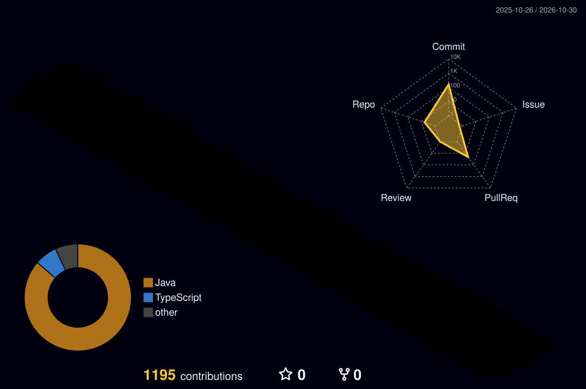

### HeeJu Kim
***************

  <!-- 1. Wave Header Banner -->
  

 

  <h2>🪐 HeeJu Kim (풀스택 개발자)</h2>

  <!-- Real-time Typing SVG -->
  

  <!-- Social Badges -->
  

    
    
    
    
    
    
    
     
    
    
    
    
    
     
    
    
    
    
    
    
  

  

   
  ---
   

  <!-- 3. 3D Core Pillars -->
  <h2>🧊 3D Core Pillars</h2>
  

    

  <!-- 7. 3D Contribution Grass & Telemetry -->
  <h2>🌱 3D Contribution Grass &amp; Telemetry</h2>
  

    

  

    
    
  

  

    
    
  

  

    
  

   

